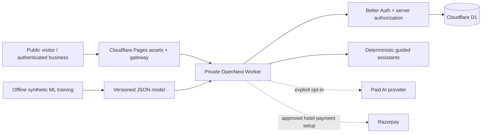

# Vashisht TravelOS repository audit and phased implementation

Audit date: 21 November 2026. Baseline: `bae2585`. Owner instruction: audit first, then Phase 1; no production deployment without approval. Source inspected; no access to production data or provider credentials is implied.

## Architecture and inventory

- Next.js 16.4.6 App Router, React 19.2.4, TypeScript, Lucide; CSS layers globals → premium → red → dark → light. Existing light appearance uses Segoe UI/system fonts. Homepage-specific CSS must be scoped so it cannot recolor private dashboards or printed documents.
- Cloudflare Pages `_worker.js` gateway forwards through `TRAVELOS_BACKEND` to `vashisht-travelos-api-staging`; despite its name this Worker serves the public deployment. OpenNext 1.20.17 bundles the Next app using Webpack. D1 binding `TRAVELOS_DB`; PostgreSQL remains a local/test and legacy path. No R2 binding/upload pipeline found.
- Better Auth: email/password, database sessions, two-factor support, invitation/disabled-account checks. Agency roles OWNER/MANAGER/AGENT, per-hotel memberships, marketplace business ownership; platform operations require allowlisted, verified MFA identity. See `src/lib/access.ts`, `data.ts`, `operator-access.ts`, `hotels/service.ts`, marketplace `core.ts`.
- Public routes: `/`, `/features`, `/pricing`, `/product-demo`, `/contact`, legal pages, `/hotel-business`, `/stays`, `/marketplace`, campaign `/trips/[slug]`. Agency `/workspace`; hotels `/hotelier`; buses `/operator`, cars `/operator?kind=CAR`; read-only `/demo`; admin `/admin`, `/admin/hotels`, `/admin/marketplace`. Preserve these entry points.
- Six additive D1 migrations: baseline, record versions, campaigns, hotel core, B2B marketplace, verified referrals. SQL-managed marketplace tables coexist with Prisma models. Never substitute a PostgreSQL migration for D1.

## Working code, limits and gaps

These are source/local-test findings, not claims of live production recovery.

| Area | Existing implementation | Gaps / next work |
|---|---|---|
| Agency CRM | Tenant-scoped enquiries, pipeline cards, follow-ups, packages, snapshotted quotations, bookings, manual collections/expenses, suppliers, exports, team/settings | Pipeline is not drag-and-drop; customer timeline, full itinerary builder and departure calendar need explicit workflows, not renamed menu placeholders. Data fetch currently loads bounded permitted datasets; scale pagination needs measurement. |
| Reports | Overview, analytics, BI, monthly/source/package contribution, printable documents | Not statutory accounting; no closed-period snapshots. |
| Hotel | Draft onboarding, independent approval, room categories, nightly pricing/inventory, atomic expiring holds, policy snapshots, cancellation/refund states, scoped checkout | Complete check-in/out operations and validated occupancy forecasting are not yet present. Real provider delivery/settlements require onboarding and verification. |
| Transport | Bus/car listings, full-vehicle trip/km quotes, blackout dates, operator confirmation, driver assignment, expense/revenue records | Shared operator implementation with distinct entry paths; no live seat ticketing. Preserve bus/car selection. |
| AI | Structured enquiry extraction, campaign/hotel guides, permission checks, paid-service flags, backend-priced quotes and human handoff patterns | Paid AI off by default. Not a fully autonomous financial agent. Unified tenant credit ledger/tool approvals and business advisor remain future work. |
| ML | Reproducible synthetic sklearn logistic regression, held-out metrics, exported coefficients, parity tests | Synthetic performance does not establish real-agency accuracy. No validated 7/30/90-day demand model, occupancy model, calibration/drift service or shared-data consent system. |
| SaaS billing | 14-day agency trial, seat/enquiry caps, manual subscription requests and MFA-admin review | No automated SaaS checkout, recurring subscription webhook lifecycle, tax invoices or annual billing. Existing Razorpay integration concerns hotel booking payments, not subscription billing. |
| Marketplace business model | Editable plans and eligibility-based commission snapshots, immutable adjustments and settlement journals | Conflicts with new subscription-only instruction. Future offers must use a versioned no-commission policy; preserve existing agreements, balances, historical snapshots and contractual rights. |
| Ads / messaging | OAuth integration code, campaign attribution and guarded messaging hooks | Provider app approvals/credentials and live consent/setup remain required; not assumed connected. |
| Operations | Additive migrations, backup runbooks, health routes, request correlation, CI, local D1/browser suites | Recurring production HTTP 500 remains unresolved; no production access or confirmed recovery. Hosted restore rehearsal, full accessibility/performance/security assessment still required. |

## Production blocker and evidence limits

See `docs/RUNTIME-INCIDENT-2026-11-19.md`. Provided backend trace returns 500 during Next `waitUntilLoaded → ensureUserland → prepareExecution`. This points to route-loading execution; original exception/message is absent, so the root cause is unproven. CPU 10 ms and outcome `ok` do not establish CPU exhaustion. Local cold parallel bus search passed previously. Do not upgrade paid infrastructure or edit production data based on this hypothesis.

Direct requests to the live origin and both inspiration websites are currently rejected by this environment's outbound proxy (CONNECT 403). Their rendered appearance was not reviewed. Implement the supplied visual direction originally; do not claim pixel comparison. A saved domain-access draft still needs user publication. No copying of branding, source, imagery or customer claims.

## Security / test findings

- Preserve fresh server-side identity, tenant filters, agent assignment, hotel memberships and MFA-admin checks. UI visibility alone is not authorization.
- Keep D1 multi-record operations native/atomic; the safe adapter rejects interactive transactions instead of pretending they succeeded. Retain race/idempotency/cross-business tests.
- Preserve server-side Razorpay signatures, verified capture and idempotent event processing. No browser callback may activate a subscription or confirm inventory.
- R2 must be added with file size/type validation, ownership, approved delivery origins and cleanup policy before uploads are advertised.
- The default paid-AI/WhatsApp/live-payment gates remain off. Future tenant AI credits require durable reservations/reconciliation, limits and cost reporting before provider calls.
- Existing tests cover CRM, cross-tenant requests, D1 atomicity, webhook retries, refunds, campaign isolation, ML parity and browser journeys. Missing coverage includes real production failure reproduction, carousel accessibility/swipe/reduced motion, hosted restore, subscription lifecycle, model backtesting/calibration/drift and provider approvals.
- Existing docs include older Render/manual-production notes. Treat source/config and dated verification as authoritative; do not infer live readiness from an old checklist.

## Phased plan and acceptance gates

0. **Audit:** this report, safe feature branch, evidence/status inventory and explicit no-deploy boundary.
1. **Premium homepage:** original navy/lavender/purple-blue design; isolated CSS; five-slide 6-second hero with pause/manual/swipe/reduced-motion support; labeled fictional product previews; interactive scroll-linked feature story; agency/hotel/bus/car entry links; AI/intelligence availability labels; how-it-works; proposed agency 499/999/1999 monthly pricing; hotel/transport contact/configuration; demo/FAQ/contact/footer. No backend calls for hero/demo pricing, no fake testimonials, no billing mutations. Tests must cover controls, keyboard/focus/hover, swipe, hidden/reduced-motion behavior, feature story, mobile overflow and navigation.
2. **Workspace improvements:** retain real existing modules, add customer history, itinerary/costing and departure workflows incrementally. Separate design tokens from access rules. Add missing operations only with working endpoints and permission tests; no empty menu placeholders.
3. **AI tools:** scoped read tools first, then draft-writing tools with explicit user approvals; deterministic prices/availability/payment truth; durable usage/credit quotas, consent, cost reconciliation, human handoff. Default disabled paid actions remain disabled.
4. **Intelligence engine:** seasonal-naive baselines and insufficient-data states; time-ordered backtesting and uncertainty; logistic/tree comparison, calibration and prediction-time feature checks; contribution calculations and non-causal attribution. Use real tenant data only under appropriate consent/basis; never pool private data silently.
5. **ML serving:** offline Python artifacts first; store model version, tenant scope, trained-at/as-of, feature schema, split/evaluation metrics and predictions. FastAPI only if measured requirements justify a separate service; do not add paid infrastructure by default.
6. **Subscription-only billing:** versioned offer catalogue, monthly/annual terms, Razorpay subscription service distinct from hotel payments, verified webhook inbox, entitlements, credit limits, retries, renewal/cancellation/export, billing history and invoices. Existing contracts grandfathered/migrated only with explicit consent; future marketplace commission policy zero under new offers. No automatic deductions or live transactions in Phase 1.
7. **Production quality:** fix demonstrated 500 cause; full server/D1/browser security suites, accessibility/performance assessment, backup/restore and private-data checks; then request explicit production approval for a concrete release.

## Additive migration / API roadmap (not executed in Phase 1)

- Versioned `SubscriptionOffer`, `BusinessSubscription`, `SubscriptionEventInbox`, `BillingInvoice`, `EntitlementSnapshot`; immutable provider IDs/event uniqueness and explicit legacy contract mapping. Do not overwrite Agency/MPSubscription negotiated values.
- `AIUsageReservation`, `AIUsageEvent`, `ToolApproval`, with tenant+idempotency uniqueness, quota reservation/refund reconciliation and retention rules.
- `ModelVersion`, `ModelEvaluation`, `ForecastRun`, `ForecastPoint`, `PredictionAudit`, with tenant scope/as-of dates and model provenance. Avoid raw customer messages in model artifacts/logs.
- Operational additions only when required: scoped customer timeline, itinerary versions/items, check-in/out event log; reuse existing lead/quotation/booking references.
- API families: authenticated `/api/subscriptions/*` and signed provider webhook; `/api/ai/tools/*` approval/reservation boundaries; `/api/intelligence/*` permissioned computed/read results; existing hotel/transport contracts stay compatible. Each write derives actor/business from session and enforces idempotency/revision.
- Migration procedure: verify restore point, apply additive D1 migration on disposable local DB, test old and new contracts and cross-tenant denial, review SQL, stage/restore rehearsal, then request approval. Production backup and migration are not performed during this UI phase.

## Phase 1 delivery / deployment boundary

Homepage code and tests will be committed locally on `feature/premium-homepage-20261121`. Do not push main or invoke release/deploy commands. A branch push may itself trigger provider preview builds, so do not push without approval. Existing production stays unchanged. Publish later only after the runtime incident gate, agreed offer wording, regression checks and explicit approval.
